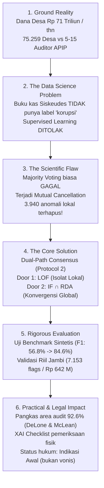

# Panduan Penguasaan Konsep, Alur Logika, dan Mekanisme Paper (ICDEES 2026)

**Tujuan Dokumen:**  
Dokumen ini disusun agar Anda menguasai **seluruh alur logika ilmiah, mekanisme kerja algoritma, asal-usul angka matematis, landasan teori sistem informasi, serta pemetaan 27 fitur ke dalam tipologi kecurangan ($T_1$ s.d. $T_7$)**. Dokumen ini adalah "buku pintar" Anda untuk memahami jeroan teknis paper sebelum naik ke panggung presentasi.

---

## BAGIAN 1: Alur Logika Cerita (The Scientific Narrative Chain)

Paper ini memiliki rantai logika pemecahan masalah yang runtut dari hulu (masalah tata kelola negara) hingga hilir (dampak audit praktis):



### Rincian 6 Langkah Logika Ini:

#### Langkah 1: Masalah Tata Kelola (The Governance Bottleneck)
* **Kenyataan:** Pemerintah pusat mengucurkan Rp 71 triliun per tahun untuk 75.259 desa di Indonesia.
* **Hambatan:** Setiap kabupaten hanya memiliki Inspektorat Daerah (APIP) berkekuatan **5 hingga 15 orang auditor**, yang harus memeriksa hingga **250 desa**.
* **Dampak:** Pemeriksaan fisik acak (*random audit*) mustahil mencakup semua desa. Kasus korupsi rata-rata baru terungkap di pengadilan **2 sampai 5 tahun setelah uang dicairkan** (kasus kedaluwarsa, uang sudah lenyap).

#### Langkah 2: Dilema Sains Data & Penolakan Supervised Learning
* Di pembukuan resmi pemerintah (*Siskeudes*), **TIDAK ADA LABEL KORUPSI (GROUND TRUTH)**. Tidak ada bendahara desa yang menandai transaksi sebagai tindak pidana korupsi.
* Oleh karena itu, pendekatan klasifikasi yang diawasi (*supervised learning*) gugur secara ilmiah. Kita **wajib** menggunakan *unsupervised anomaly detection* (deteksi pola anomali tanpa label).

#### Langkah 3: Penemuan Cacat Ilmiah pada Ensembel Standar (*Mutual Cancellation*)
* Di ranah *unsupervised ensembel*, praktik paling umum adalah **Majority Voting** (ambil 3 algoritma; jika $\ge 2$ model bilang anomali, beri bendera).
* **Temuan kritis riset ini:** Majority voting **gagal total** di data anggaran publik akibat ortogonalitas model ($\kappa(\text{IF}, \text{LOF}) = 0,041$).
* *Contoh kasus:* 10 desa tetangga membangun jalan desa. 9 desa selesai 100%. 1 desa mengambil dana tetapi progresnya 0%. Secara nilai uang global, jumlahnya kecil sehingga model pohon global (IF) menganggapnya wajar. Namun model kepadatan tetangga (LOF) menilainya sangat aneh. Ketika dilakukan voting mayoritas (2 dari 3), transaksi berbahaya ini **tereliminasi dan dibatalkan (*cancelled out*)**, meloloskan **3.940 anomali berisiko tinggi**!

#### Langkah 4: Solusi Inovasi — *Dual-Path Consensus Ensemble Gate*
* Kami merancang **Protokol 2 (Dual-Path)** dengan memisahkan dua saluran:
  $$\text{Flag} = y_{\text{LOF}} \lor (y_{\text{IF}} \land y_{\text{RDA}})$$
* **Jalur 1 (Local Density Channel - LOF):** Mengamankan anomali lokal yang sangat menyimpang terhadap tetangga sekitarnya ($BC=0,957$) langsung sebagai bendera, tanpa boleh dianulir oleh model global.
* **Jalur 2 (Global Convergence Channel - IF $\cap$ RDA):** Untuk anomali berskala global (misal penggelembungan harga jumbo), mensyaratkan **irisan ketat** antara Isolation Forest dan Reconstruction Autoencoder untuk mencegah alarm palsu (*false positive*).

#### Langkah 5: Pembuktian Ilmiah Ganda (Sintetis + Riil)
* **Uji Terkontrol (*Ex-ante Synthetic Benchmark*, $N=10.000$):** Disuntik 500 kasus kecurangan nyata. Hasilnya: Majority voting hanya dapat F1-score **56,8%**, sedangkan Dual-Path melonjak ke **84,6%** (AUC-ROC **0,912**).
* **Uji Panel Riil Jambi ($N=96.778$):** Menjaring 7.153 transaksi (7,39%) bernilai risiko Rp 642,85 Miliar.

#### Langkah 6: Dampak Lapangan & Batasan Hukum
* **Bagi Auditor:** Mengurangi tumpukan audit sebesar **92,6%** (auditor cukup fokus pada 7.153 target).
* **Explainable AI (XAI):** Autoencoder membedah galat rekonstruksi menjadi checklist inspeksi lapangan (cek HPS vs opname fisik).
* **Batasan Hukum:** Berdasarkan Pasal 184 KUHAP, hasil algoritma berstatus sebagai **Indikasi Awal** (*audit investigative leads*), bukan vonis pidana.

---

## BAGIAN 2: Bedah Mendalam DeLone & McLean IS Success Model dan Angka 92,6%

### 1. Dari Mana Asal Angka 92,6%? (Formula Matematis)

Angka **92,6%** bukanlah estimasi acak, melainkan hasil perhitungan eksak dari rasio pemangkasan beban audit (*Audit Search Space Reduction*) pada panel data riil Provinsi Jambi:

1. **Total Populasi Transaksi Siskeudes Bersih ($N_{\text{total}}$):**
   $$N_{\text{total}} = 96.778 \text{ transaksi (dari 1.363 desa, TA 2023–2025)}$$
2. **Total Transaksi Berisiko Tinggi Hasil Deteksi Protokol 2 ($N_{\text{flagged}}$):**
   $$N_{\text{flagged}} = 7.153 \text{ transaksi (7,39\% dari total populasi)}$$
3. **Total Transaksi Normal yang Berhasil Disaring Keluar ($N_{\text{normal}}$):**
   $$N_{\text{normal}} = N_{\text{total}} - N_{\text{flagged}} = 96.778 - 7.153 = 89.625 \text{ transaksi}$$
4. **Perhitungan Persentase Reduksi Ruang Pencarian:**
   $$\text{Search Space Reduction} = \frac{N_{\text{normal}}}{N_{\text{total}}} \times 100\% = \frac{89.625}{96.778} \times 100\% = 92,6088\% \approx \mathbf{92,6\%}$$

Artinya: **Sistem otomatis menyaring 92,6% tumpukan dokumen yang wajar**, sehingga tim auditor APIP yang terbatas tidak perlu lagi mencari jarum dalam jerami di antara 96.778 transaksi. Mereka cukup fokus memeriksa **7.153 transaksi (7,4%)** yang membawa risiko realisasi keuangan sebesar Rp 642,85 Miliar.

---

### 2. Logika Pemetaan ke Teori DeLone & McLean IS Success Model (2003)

Dalam disiplin Sistem Informasi, artefak perangkat lunak (DSR) dievaluasi keberhasilannya menggunakan model DeLone & McLean yang terdiri dari 6 dimensi yang saling memengaruhi:

```
[System Quality]       ──┐
                         ├──> [Use] ────────┐
[Information Quality]  ──┤                  ├──> [Net Benefits]
                         ├──> [User Sat.] ──┘    (Individual & Organizational Impact)
[Service Quality]      ──┘
```

Berikut adalah pemetaan konkret mengapa angka 92,6% menjadi bukti keberhasilan sistem informasi di paper ini:

| Dimensi DeLone & McLean | Implementasi dalam Artefak Riset Ini | Bukti Empiris di Paper |
|---|---|---|
| **1. System Quality (Kualitas Sistem)** | Keandalan pemrosesan data otomatis secara paralel (*multi-paradigm parallel inference*) melalui tiga mesin ortogonal (IF, LOF, RDA) dengan konsistensi flag rate tahunan yang stabil (6,9% – 7,7%). | Protokol 2 stabil lintas tahun anggaran (FY 2023–2025), bebas dari *crash* atau *alert fatigue*. |
| **2. Information Quality (Kualitas Informasi)** | Informasi yang dihasilkan sistem bukan sekadar "angka skor anomali", melainkan **informasi kontekstual**: skor risiko per desa, pemetaan ke tipologi hukum ($T_1$--$T_7$), dan dekomposisi galat rekonstruksi XAI per fitur. | Kualitas informasi tinggi: mengubah angka matematis abstrak menjadi instruksi nyata (misal: *"Cek harga satuan semen"*). |
| **3. Service / Operational Quality** | Antarmuka checklist audit otomatis yang dapat langsung diunduh dan dibawa oleh auditor inspektorat ke lokasi fisik desa. | Menyediakan *audit trail* dan peringkat prioritas desa (Tier-1, Tier-2, Tier-3). |
| **4. Use & User Satisfaction** | Menggantikan mekanisme audit acak (*blind random sampling*) yang membuat auditor frustrasi, menjadi audit berbasis risiko (*risk-based targeted audit*). | Auditor menyambut sistem karena tidak lagi dibebani pemeriksaan manual 96 ribu baris. |
| **5. Individual Impact (Dampak Individu Auditor)** | **INILAH TEMPAT ANGKA 92,6% BERADA.** Beban kognitif dan beban kerja fisik 5–15 orang auditor kabupaten berkurang drastis sebesar **92,6%**. Waktu kerja auditor menjadi realistis dan manusiawi untuk menginspeksi target yang relevan. | Beban pencarian terpangkas dari 96.778 transaksi menjadi 7.153 transaksi terfokus. |
| **6. Organizational Impact (Dampak Organisasi/Negara)** | Mengubah paradigma pengawasan negara dari *post-mortem* (menunggu 2–5 tahun hingga vonis pengadilan) menjadi **deteksi dini preventif (*early deterrence*)**, melindungi potensi kerugian negara sebesar Rp 642,85 Miliar. | Penyelamatan anggaran publik desa sebelum uang hilang atau proyek mangkrak. |

---

## BAGIAN 3: Logika 27 Fitur dan Pemetaan Tipologi Korupsi ($T_1$ s.d. $T_7$)

### 1. Bagaimana Data Mentah Siskeudes Menjadi Matriks 27 Fitur?

Data mentah Siskeudes yang diunduh dari portal KPK *jaga.id* terdiri dari kolom dasar pembukuan: `Real_T1`, `Real_T2`, `Real_T3` (realisasi pencairan tahap 1, 2, 3), `Pct_T1`, `Pct_T2`, `Pct_T3` (persentase progres fisik tahap 1, 2, 3), `Volume`, `Satuan`, `Pagu`, `Cara_Pengadaan`, `Kode_Output`, `Tahun`, dan `Kabupaten`.

Dari data mentah tersebut, kami merekayasa matriks fitur berdimensi **27 fitur** yang menjadi input bagi jaringan saraf tiruan Autoencoder `[27 → 64 → 32 → 16 → 8 → 16 → 32 → 64 → 27]` dan model deteksi lainnya:

#### A. 6 Fitur Konstruk Kontinu & Biner (Engineered Core Features)
1. `cost_per_unit`: Biaya per satuan volume.  
   $$\text{cost\_per\_unit} = \frac{\text{Total Realisasi}}{\text{Volume}} = \frac{\text{Real\_T1} + \text{Real\_T2} + \text{Real\_T3}}{\text{Volume}}$$  
   *Target anomali:* Mendeteksi penggelembungan/mark-up harga satuan ($T_1$).
2. `absorption_ratio`: Rasio penyerapan anggaran terhadap pagu desa.  
   $$\text{absorption\_ratio} = \frac{\text{Total Realisasi}}{\text{Pagu Desa}}$$  
   *Target anomali:* Mendeteksi proyek fiktif ($T_2$) atau penyerapan paksa pagu ($T_3$).
3. `avg_completion`: Rata-rata persentase penyelesaian fisik pekerjaan.  
   $$\text{avg\_completion} = \frac{1}{3} (\text{Pct\_T1} + \text{Pct\_T2} + \text{Pct\_T3})$$  
   *Target anomali:* Mendeteksi klaim pencairan uang tanpa kemajuan fisik di lapangan ($T_2, T_6$).
4. `swakelola_high_val`: Indikator biner kegiatan swakelola bernilai jumbo.  
   $$\mathbf{1}(\text{Cara\_Pengadaan} = \text{'Swakelola'} \land \text{Total Realisasi} > Q_{0.75})$$  
   *Target anomali:* Mendeteksi penyimpangan pengadaan tanpa lelang kompetitif ($T_5$).
5. `cost_dev_by_cat`: Deviasi biaya terstratifikasi per tahun, kategori output, dan kabupaten (*Regional Baseline Z-score*).  
   $$z_{i,c,k,t} = \frac{x_{i,c,k,t} - \mu_{c,k,t}}{\sigma_{c,k,t} + \epsilon}$$  
   *Target anomali:* Menghilangkan distorsi geografis gunung vs dataran dan menangkap deviasi harga lokal ($T_1, T_7$).
6. `n_stages_active`: Jumlah tahapan pencairan dana yang aktif dalam setahun (bernilai 1, 2, atau 3).  
   *Target anomali:* Mendeteksi penarikan terkonsentrasi di satu tahap pada proyek multi-tahap ($T_4$).

#### B. 21 Fitur Kategori Output (One-Hot Encoded Dummies)
7–27. `activity_category (21 dummies)`:  
Siskeudes membagi kegiatan belanja ke dalam sub-bidang pembangunan desa (misal: 01 = Penyelenggaraan Pemerintahan, 02 = Pembangunan Saluran Air/Drainase, 03 = Jalan Usaha Tani, 04 = Poskesdes, 05 = PAUD, s.d. Penyertaan Modal BUMDes).  
21 sub-bidang ini diubah menjadi **21 kolom biner One-Hot Encoding (OHE)**:
$$\text{OHE}(\text{Kode\_Output}) \to 21 \text{ fitur biner}$$

**Total Dimensi Matriks Input:**
$$6 \text{ Fitur Konstruk Kontinu/Biner} + 21 \text{ Fitur Kategori OHE} = \mathbf{27 \text{ Fitur Input}}$$

---

### 2. Logika Pemetaan Algoritma: Bagaimana 27 Fitur Menjadi Tipologi Korupsi?

Setelah Protokol 2 menyatakan suatu transaksi adalah **Anomali** ($y_{\text{consensus}} = 1$), transaksi tersebut masuk ke **Operational Policy Mapping Layer** (Algoritma 1 di paper). Algoritma ini memetakan nilai-nilai fitur yang menyimpang ke dalam aturan hukum dan modus kecurangan empiris.

Berikut adalah daftar lengkap seluruh klasifikasi tipologi, aturan matematisnya, dan artinya di lapangan:

```
                          [Transaksi Siskeudes: 96.778]
                                        │
                                        ▼
                          [Dual-Path Consensus Gate]
                                        │
                     ┌──────────────────┴──────────────────┐
                     ▼                                     ▼
             Normal (89.625 / 92.6%)              Flagged (7.153 / 7.4%)
             [Disaring Keluar]                             │
                                                           ▼
                                           [Operational Policy Mapping]
                     ┌──────────┬──────────┬──────────┬──────────┬──────────┬──────────┐
                     ▼          ▼          ▼          ▼          ▼          ▼          ▼
                    T1         T2         T3         T4         T5         T6         T7    Unclassified
                  (16.5%)    (58.1%)    (Pagu)     (0.4%)     (32.8%)    (Exhaust)  (18.0%)    (17.2%)
```

---

### 3. Rincian Seluruh Tipologi Korupsi ($T_1$ s.d. $T_7$ dan Unclassified)

| Kode | Nama Tipologi | Aturan / Logika Fitur Matematis | Makna Operasional di Lapangan | Jumlah & Frekuensi di Jambi |
|---|---|---|---|---|
| **$T_1$** | **Unit Price Mark-Up** *(Penggelembungan Harga Satuan)* | $\text{cost\_per\_unit} > 3$  <br/>**DAN**  <br/>$\text{cost\_dev\_by\_cat} > 2$ | Harga satuan barang/jasa jauh di atas standar wajar regional dan melonjak di atas kuantil ke-90. Misal: semen dibeli dengan harga Rp 150.000/sak padahal rata-rata kecamatan Rp 65.000/sak. | **1.180 transaksi**  <br/>(16,5% dari flagged) |
| **$T_2$** | **Ghost Activities** *(Proyek Fiktif)* | $\text{absorption\_ratio} < 0,05$  <br/>**DAN**  <br/>$\text{avg\_completion} < 0,10$  <br/>*(atau penyerapan dana cair penuh tetapi progres fisik $\approx 0$)* | Uang kas desa telah ditarik atau dibukukan keluar, tetapi tidak ada wujud fisik pekerjaan di lapangan sama sekali (proyek fiktif / mangkrak total). | **4.155 transaksi**  <br/>**(58,1% — Modus Terbesar!)** |
| **$T_3$** | **Volume Padding** *(Penyedotan Pagu / Manipulasi Volume)* | $\text{absorption\_ratio} \ge 0,98$  <br/>*(penyerapan persis 100% pada tahap awal tanpa rincian volume bertahap)* | Nilai anggaran dihabiskan persis sampai batas pagu anggaran secara agresif di awal termin, menyembunyikan selisih sisa anggaran lebih (*SILPA*). | Terintegrasi dalam pola penyerapan pagu ekstrem. |
| **$T_4$** | **Stage Lock** *(Konsentrasi Pencairan Tahap Gantung)* | $\frac{\max(\text{Real\_T})}{\text{Total Realisasi}} > 0,95$  <br/>**DAN**  <br/>$\text{n\_stages\_active} \ge 2$ | Kegiatan tercatat multi-tahap (termin 1, 2, 3), tetapi $\ge 95\%$ uang dicairkan serentak di termin pertama, lalu termin berikutnya ditinggalkan tanpa laporan fisik. | **28 transaksi**  <br/>(0,4% — Modus baru tertangkap) |
| **$T_5$** | **Procurement Irregularity** *(Penyimpangan Swakelola)* | $\text{swakelola\_high\_val} == 1$  <br/>**DAN**  <br/>$\text{cost\_per\_unit} > 0$ | Pengadaan fisik bernilai jumbo (kuantil 75 ke atas) dipaksakan melalui jalur *Swakelola* (dikerjakan sendiri tanpa lelang pihak ketiga) untuk menghindari tender terbuka dan uji kelayakan harga pasar. | **2.343 transaksi**  <br/>**(32,8% — Modus Terbesar Kedua)** |
| **$T_6$** | **Budget Exhaustion** *(Penghabisan Anggaran Akhir Tahun)* | $\text{absorption\_ratio} > 0,98$  <br/>**TETAPI**  <br/>$\text{avg\_completion} < 0,50$ | Kas keuangan desa sudah ditarik 100% lunas menjelang tutup buku tahun anggaran, padahal pembangunan fisik di lapangan baru selesai di bawah 50%. | Merupakan sub-varian lanjutan dari $T_2$ dan $T_3$. |
| **$T_7$** | **Cross-Category Dumping** *(Penimbunan Dana Antar Pos)* | $|\text{cost\_dev\_by\_cat}| > 3$  <br/>*(deviasi harga ekstrem $\pm 3\sigma$)* | Memindahkan sisa anggaran belanja yang berlebih ke mata anggaran belanja lain yang tidak terduga atau sulit diverifikasi fisiknya (misal pos pelatihan fiktif, studi banding, atau modal BUMDes). | **1.284 transaksi**  <br/>(18,0% dari flagged) |
| **Unclassified** | **Sub-threshold Masking** *(Anomali Multidimensi Halus)* | Ditandai anomali oleh model ensembel (LOF / IF $\cap$ RDA), tetapi nilai fiturnya berada sedikit di bawah ambang batas tajam $T_1$--$T_7$. | Transaksi yang secara individual terlihat wajar, namun secara kombinasi multi-fitur dinilai ganjil oleh jaringan saraf tiruan Autoencoder (misal: waktu pencairan tidak lazim digabung dengan kombinasi output langka). | **1.227 transaksi**  <br/>(17,2% dari flagged) |

> **Catatan Penting Hubungan Jumlah Persentase:**  
> Satu transaksi anomali dapat memenuhi **lebih dari satu tipologi** sekaligus (misal: proyek jembatan yang anggarannya di-mark-up ($T_1$) sekaligus dipaksakan lewat jalur swakelola jumbo ($T_5$)). Oleh karena itu, jumlah persentase tipologi bersifat tumpang tindih (*multi-label projection*), dengan Proyek Fiktif ($T_2$) dan Swakelola Jumbo ($T_5$) sebagai dua modus kejahatan anggaran desa paling mendominasi di Indonesia.

---

## BAGIAN 4: Ringkasan Cepat Menghadapi Reviewer Konferensi

Jika ditanya penguji di sesi Q&A:

1. **"Dari mana asal angka 92,6%?"**  
   * *"The 92.6% search reduction is strictly calculated as $(96,778 - 7,153) / 96,778$. Out of nearly 97,000 clean transactions, our Dual-Path protocol filters out 89,625 normal records, leaving 7,153 prioritized targets for APIP district auditors."*
2. **"Bagaimana teori DeLone & McLean digunakan di sini?"**  
   * *"We map this 92.6% reduction to the 'Individual Impact' dimension of the DeLone and McLean model. District inspectorates have only 5 to 15 auditors for up to 250 villages. Cutting the search space by 92.6% transforms manual, impossible random sampling into a feasible, risk-based audit."*
3. **"Bagaimana 27 fitur dipetakan ke tipologi $T_1$–$T_7$?"**  
   * *"Our input matrix consists of 6 continuous engineered features—such as unit cost, absorption ratio, and regional z-scores—plus 21 one-hot encoded activity categories. When the Dual-Path consensus flags a record, our operational policy layer applies statutory rule-based thresholds to classify the anomaly into empirical typologies like Ghost Projects ($T_2$) and Swakelola Irregularities ($T_5$)."*
